<div align="center">

<picture><source media="(prefers-color-scheme: dark)" srcset="assets/v2/hero-dark.svg">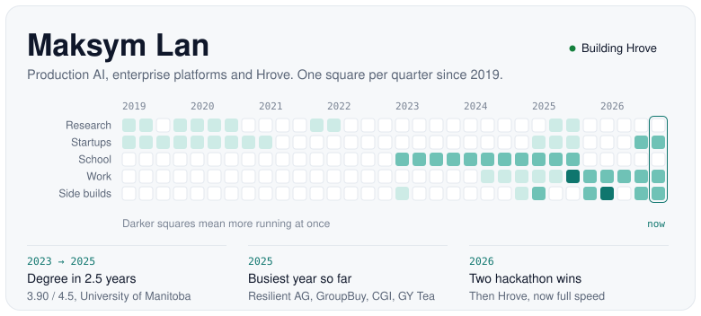</picture>

</div>

<p align="center"><a href="https://maksym-lan-personal-website.vercel.app/">Portfolio</a> · <a href="https://www.linkedin.com/in/maksym-lan/">LinkedIn</a> · <a href="mailto:lanmaksym@gmail.com">Email</a> · Winnipeg, Canada</p>

```console
$ whoami
maksym-lan  # software developer @ CGI · principal dev @ GY Tea
            # building Hrove

$ cat origin-story.txt
Started out modelling neutron stars and HII regions in the Lviv science fair days.
Discovered that software ships faster than stars collapse. Stayed for the deploys.
```

## Selected work

<div align="center">

<picture><source media="(prefers-color-scheme: dark)" srcset="assets/v2/work/hrove-dark.svg">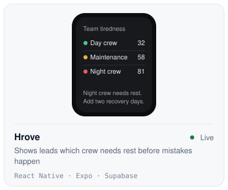</picture>
<picture><source media="(prefers-color-scheme: dark)" srcset="assets/v2/work/gytea-dark.svg">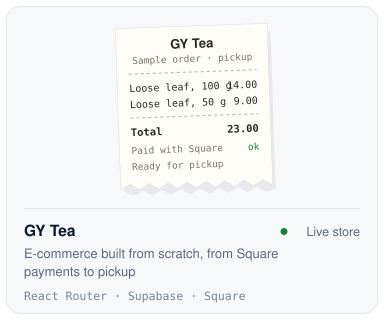</picture>
<picture><source media="(prefers-color-scheme: dark)" srcset="assets/v2/work/agentgit-dark.svg">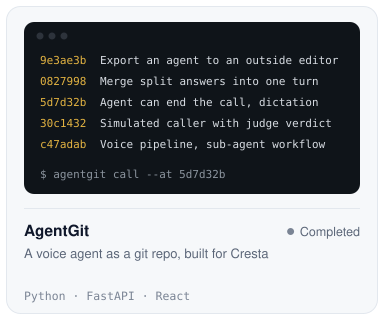</picture>
<picture><source media="(prefers-color-scheme: dark)" srcset="assets/v2/work/ecopulse-dark.svg">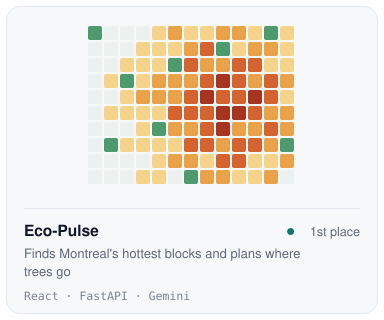</picture>
<picture><source media="(prefers-color-scheme: dark)" srcset="assets/v2/work/zonesmart-dark.svg">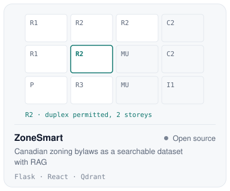</picture>
<picture><source media="(prefers-color-scheme: dark)" srcset="assets/v2/work/triageflow-dark.svg">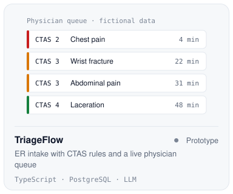</picture>

</div>

<p align="center"><a href="https://hrove.ca/">Hrove</a> · <a href="https://gytea.ca/">GY Tea</a> · <a href="https://github.com/Lushenwar/Eco-Pulse">Eco-Pulse</a> · <a href="https://github.com/MaxLan-dev/zoning-app">ZoneSmart</a></p>

<details>
<summary><b>More projects</b></summary>

<br />

<div align="center">

<picture><source media="(prefers-color-scheme: dark)" srcset="assets/v2/more/velocistock-dark.svg">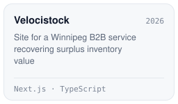</picture>
<picture><source media="(prefers-color-scheme: dark)" srcset="assets/v2/more/outreach-dark.svg">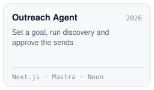</picture>
<picture><source media="(prefers-color-scheme: dark)" srcset="assets/v2/more/settlesmart-dark.svg">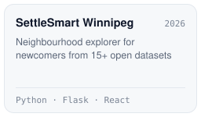</picture>
<picture><source media="(prefers-color-scheme: dark)" srcset="assets/v2/more/complaince-dark.svg">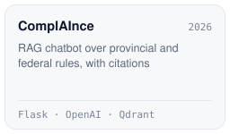</picture>
<picture><source media="(prefers-color-scheme: dark)" srcset="assets/v2/more/mailmaestro-dark.svg">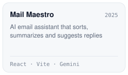</picture>
<picture><source media="(prefers-color-scheme: dark)" srcset="assets/v2/more/emailhelper-dark.svg">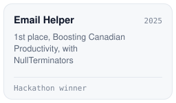</picture>
<picture><source media="(prefers-color-scheme: dark)" srcset="assets/v2/more/transit-dark.svg">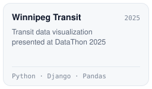</picture>
<picture><source media="(prefers-color-scheme: dark)" srcset="assets/v2/more/food4u-dark.svg">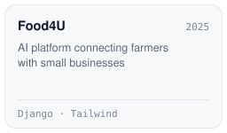</picture>
<picture><source media="(prefers-color-scheme: dark)" srcset="assets/v2/more/calorie-dark.svg">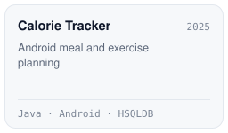</picture>
<picture><source media="(prefers-color-scheme: dark)" srcset="assets/v2/more/projectjp-dark.svg">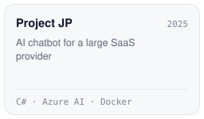</picture>
<picture><source media="(prefers-color-scheme: dark)" srcset="assets/v2/more/nasa-dark.svg">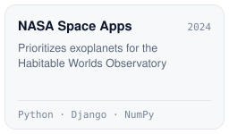</picture>
<picture><source media="(prefers-color-scheme: dark)" srcset="assets/v2/more/portfolio-dark.svg">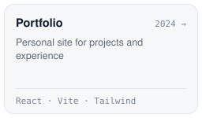</picture>
<picture><source media="(prefers-color-scheme: dark)" srcset="assets/v2/more/chat-dark.svg">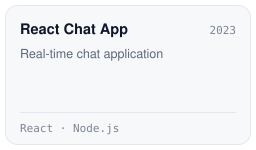</picture>
<picture><source media="(prefers-color-scheme: dark)" srcset="assets/v2/more/temethod-dark.svg">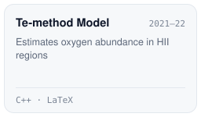</picture>
<picture><source media="(prefers-color-scheme: dark)" srcset="assets/v2/more/neutron-dark.svg">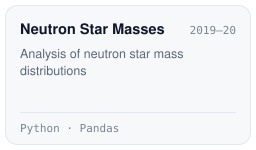</picture>

<p align="center"><a href="https://velocistock.vercel.app">Velocistock</a> · <a href="https://github.com/MaxLan-dev/agents-stuff">Outreach Agent</a> · <a href="https://github.com/alex-and-ye/SettleSmart-Winnipeg">SettleSmart Winnipeg</a> · <a href="https://github.com/tadghh/reg-compliance-chatbot">ComplAInce</a> · <a href="https://github.com/MaxLan-dev/mail-maestro">Mail Maestro</a> · <a href="https://github.com/MaxLan-dev/Email-Helper">Email Helper</a> · <a href="https://github.com/MaxLan-dev/Datathon">Winnipeg Transit</a> · <a href="https://github.com/MaxLan-dev/DevHacks2025">Food4U</a> · <a href="https://github.com/MaxLan-dev/COMP3350-WEBSITE">Calorie Tracker</a> · <a href="https://github.com/alex-and-ye/NASA-SPACE-APPS-PROJECT">NASA Space Apps</a> · <a href="https://github.com/MaxLan-dev/Maksym-Lan-Personal-Website">Portfolio</a> · <a href="https://github.com/MaxLan-dev/Chat_app">React Chat App</a></p>

</div>

</details>

## Path

<div align="center">

<picture><source media="(prefers-color-scheme: dark)" srcset="assets/v2/path/transit-dark.svg">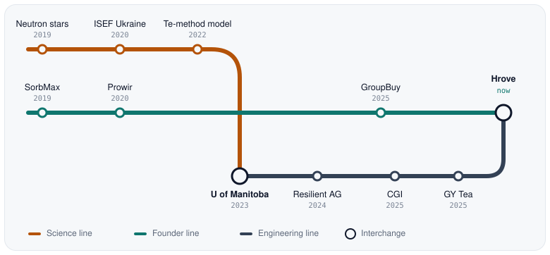</picture>

</div>

## What I build with

<div align="center">

<picture><source media="(prefers-color-scheme: dark)" srcset="assets/v2/stack/rag-dark.svg">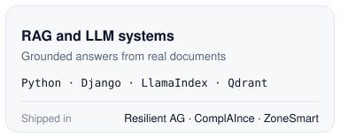</picture>
<picture><source media="(prefers-color-scheme: dark)" srcset="assets/v2/stack/enterprise-dark.svg">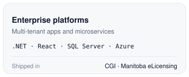</picture>
<picture><source media="(prefers-color-scheme: dark)" srcset="assets/v2/stack/product-dark.svg">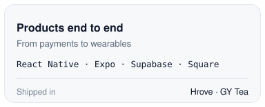</picture>
<picture><source media="(prefers-color-scheme: dark)" srcset="assets/v2/stack/voice-dark.svg">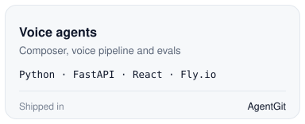</picture>

</div>

## Recognition

<div align="center">

<picture><source media="(prefers-color-scheme: dark)" srcset="assets/v2/rec/competitions-dark.svg">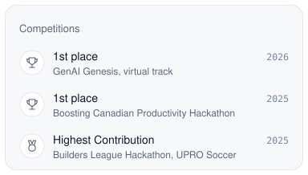</picture>
<picture><source media="(prefers-color-scheme: dark)" srcset="assets/v2/rec/honours-dark.svg">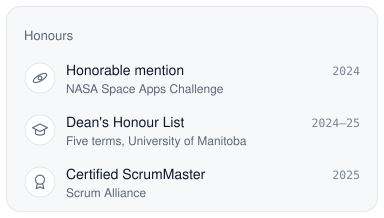</picture>

</div>

<details>
<summary><b>Earlier distinctions</b></summary>

<br />

<div align="center">

<picture><source media="(prefers-color-scheme: dark)" srcset="assets/v2/rec/projects-comp-dark.svg">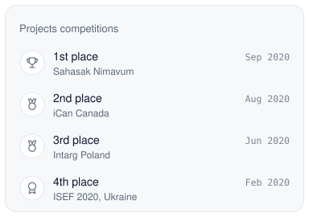</picture>
<picture><source media="(prefers-color-scheme: dark)" srcset="assets/v2/rec/jas-dark.svg">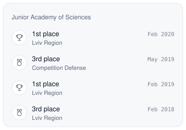</picture>
<picture><source media="(prefers-color-scheme: dark)" srcset="assets/v2/rec/also-dark.svg"></picture>

</div>

</details>

## Background

<details open>
<summary><b>Experience</b></summary>

<br />

<div align="center">

<picture><source media="(prefers-color-scheme: dark)" srcset="assets/v2/roles/cgi-dark.svg">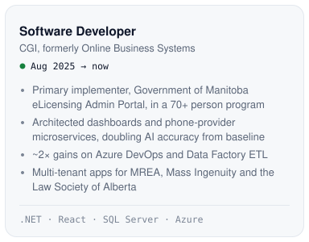</picture>
<picture><source media="(prefers-color-scheme: dark)" srcset="assets/v2/roles/resilient-dark.svg">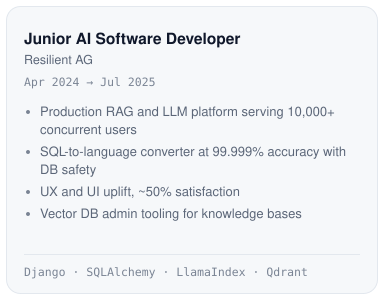</picture>
<picture><source media="(prefers-color-scheme: dark)" srcset="assets/v2/roles/gytea-dark.svg">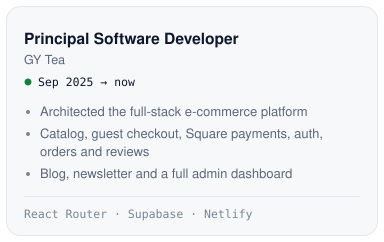</picture>
<picture><source media="(prefers-color-scheme: dark)" srcset="assets/v2/roles/groupbuy-dark.svg">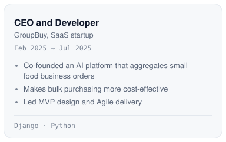</picture>
<picture><source media="(prefers-color-scheme: dark)" srcset="assets/v2/roles/research-dark.svg">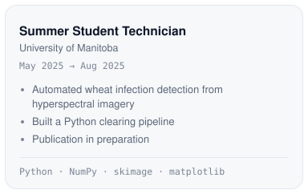</picture>
<picture><source media="(prefers-color-scheme: dark)" srcset="assets/v2/roles/startups-dark.svg">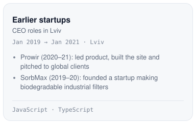</picture>

</div>

</details>

<details>
<summary><b>Education and leadership</b></summary>

<br />

<div align="center">

<picture><source media="(prefers-color-scheme: dark)" srcset="assets/v2/roles/degree-dark.svg">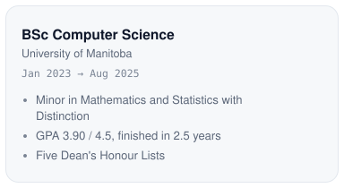</picture>
<picture><source media="(prefers-color-scheme: dark)" srcset="assets/v2/roles/aiclub-dark.svg">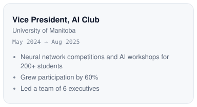</picture>
<picture><source media="(prefers-color-scheme: dark)" srcset="assets/v2/roles/ppclub-dark.svg">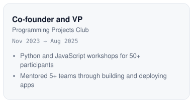</picture>
<picture><source media="(prefers-color-scheme: dark)" srcset="assets/v2/roles/community-dark.svg">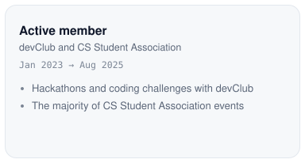</picture>

</div>

</details>

## Get in touch

<div align="center">

<picture><source media="(prefers-color-scheme: dark)" srcset="assets/v2/contact/email-dark.svg"></picture>
<picture><source media="(prefers-color-scheme: dark)" srcset="assets/v2/contact/phone-dark.svg"></picture>
<picture><source media="(prefers-color-scheme: dark)" srcset="assets/v2/contact/linkedin-dark.svg"></picture>
<picture><source media="(prefers-color-scheme: dark)" srcset="assets/v2/contact/website-dark.svg"></picture>

</div>

<p align="center"><a href="mailto:lanmaksym@gmail.com">Email</a> · <a href="tel:+12045091227">Phone</a> · <a href="https://www.linkedin.com/in/maksym-lan/">LinkedIn</a> · <a href="https://maksym-lan-personal-website.vercel.app/">Website</a></p>

<p align="center"><sub>Winnipeg, Canada · updated November 2026</sub></p>
