<div align="center">


<a href="https://maksym-lan-personal-website.vercel.app/"></a>
<a href="https://www.linkedin.com/in/maksym-lan/"></a>


</div>

```console
$ whoami
maksym-lan  # software developer @ CGI · AI developer @ Resilient AG
            # principal dev @ GY Tea · co-founder & CEO @ GroupBuy

$ cat origin-story.txt
Started out modelling neutron stars and HII regions in the Lviv science fair days.
Discovered that software ships faster than stars collapse. Stayed for the deploys.
```

<div align="center">

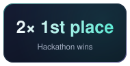
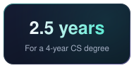
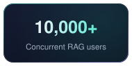
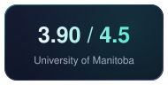

</div>

<div align="center"></div>

<div align="center">

<a href="https://hrove.vercel.app/"></a>
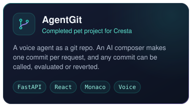
<a href="https://gytea.ca/">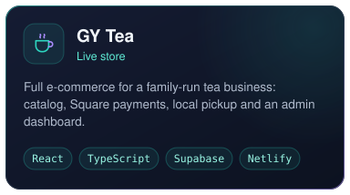</a>
<a href="https://github.com/Lushenwar/Eco-Pulse">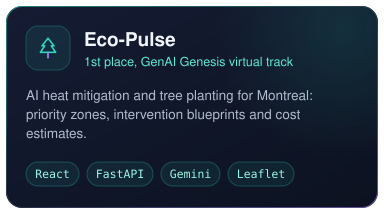</a>
<a href="https://github.com/MaxLan-dev/zoning-app">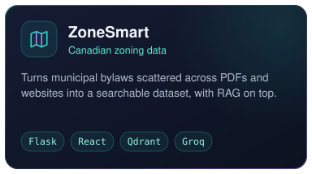</a>
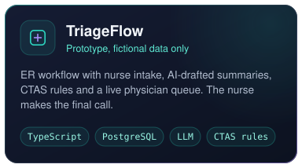

</div>

<details>
<summary><b>More projects</b></summary>

<br />

<div align="center">

<a href="https://velocistock.vercel.app">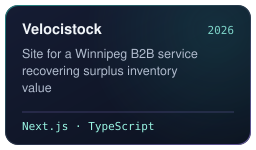</a>
<a href="https://github.com/MaxLan-dev/agents-stuff">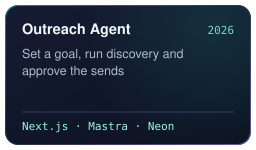</a>
<a href="https://github.com/alex-and-ye/SettleSmart-Winnipeg">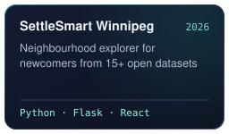</a>
<a href="https://github.com/tadghh/reg-compliance-chatbot">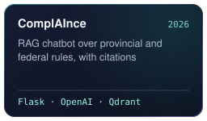</a>
<a href="https://github.com/MaxLan-dev/mail-maestro">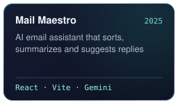</a>
<a href="https://github.com/MaxLan-dev/Email-Helper">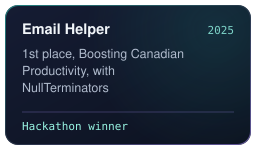</a>
<a href="https://github.com/MaxLan-dev/Datathon">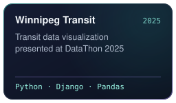</a>
<a href="https://github.com/MaxLan-dev/DevHacks2025">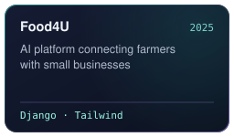</a>
<a href="https://github.com/MaxLan-dev/COMP3350-WEBSITE">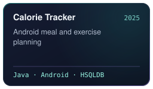</a>
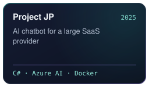
<a href="https://github.com/alex-and-ye/NASA-SPACE-APPS-PROJECT">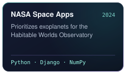</a>
<a href="https://github.com/MaxLan-dev/Maksym-Lan-Personal-Website">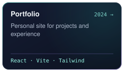</a>
<a href="https://github.com/MaxLan-dev/Chat_app">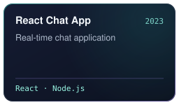</a>
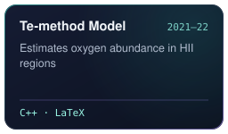
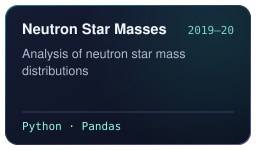

</div>

</details>

<div align="center"></div>

<div align="center">

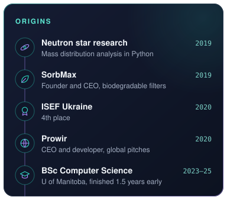

</div>

<div align="center"></div>

<div align="center">
  
</div>

<div align="center">

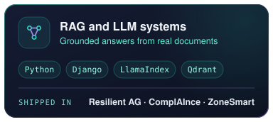
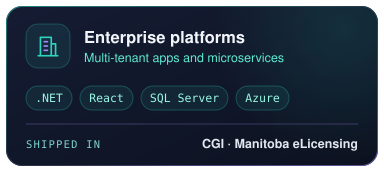
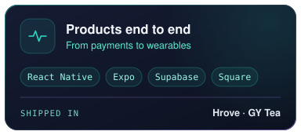
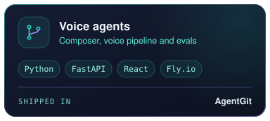

</div>

<div align="center"></div>

<div align="center">

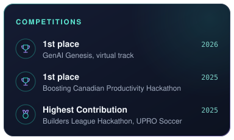
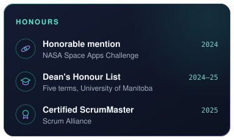

</div>

<details>
<summary><b>Earlier distinctions</b></summary>

<br />

<div align="center">

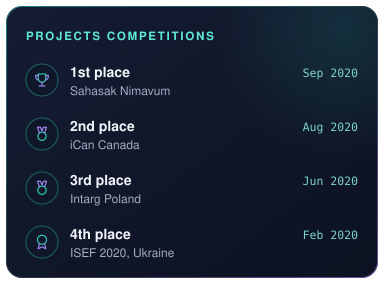
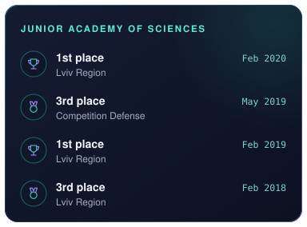
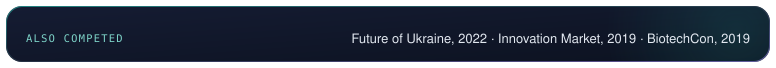

</div>

</details>

<div align="center"></div>

<details open>
<summary><b>Experience</b></summary>

<br />

<div align="center">

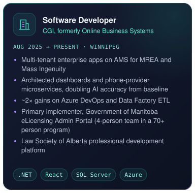
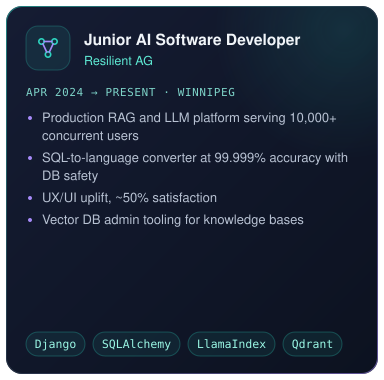
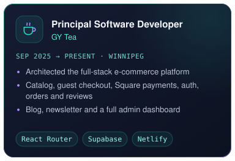
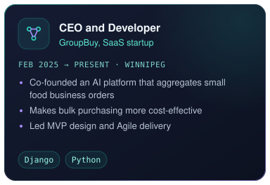
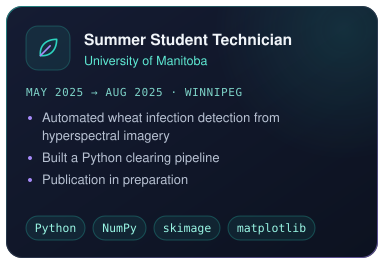
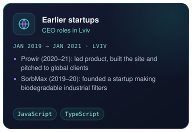

</div>

</details>

<details>
<summary><b>Education and leadership</b></summary>

<br />

<div align="center">

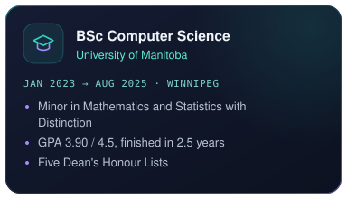
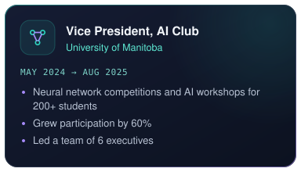
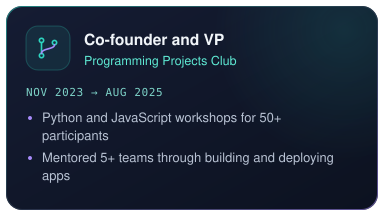
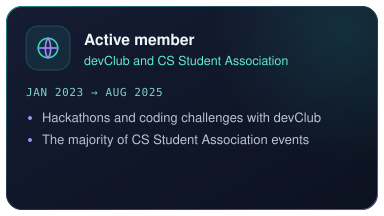

</div>

</details>

<div align="center"></div>

<div align="center">

<a href="mailto:lanmaksym@gmail.com"></a>
<a href="tel:+12045091227"></a>
<a href="https://www.linkedin.com/in/maksym-lan/"></a>
<a href="https://maksym-lan-personal-website.vercel.app/"></a>

</div>

<div align="center">

*Happy to talk AI, startups, astrophysics, or how to fit four years into two and a half.*


</div>
